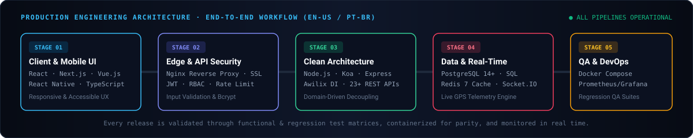

  

 

  
  
  
  
  
  

  <a href="#-english-us"><strong>🇺🇸 English (US)</strong></a>
  &nbsp;·&nbsp;
  <a href="#-português-br"><strong>🇧🇷 Português (BR)</strong></a>
  &nbsp;·&nbsp;
  <a href="#-engineering-architecture--stack"><strong>⚡ Architecture &amp; Tech Stack</strong></a>
  &nbsp;·&nbsp;
  <a href="#-featured-repositories--projects"><strong>🚀 Featured Projects</strong></a>

---

## 🇺🇸 English (US)

### Executive Summary

I am a **Full Stack Software Developer** based in Laguna, SC, Brazil (`UTC-3`), building end-to-end web and mobile applications with **React, Next.js, TypeScript, Node.js (Koa and Express), PostgreSQL, Redis, and React Native**.

My engineering approach combines **Clean Architecture** on the backend, responsive component-driven interfaces on the frontend, and a strict **Quality Assurance (QA)** mindset shaped by hands-on experience in functional and regression testing, bug lifecycle management, and Tier 2/3 production incident diagnosis.

- **Current Focus:** Designing and delivering full-stack web applications, RESTful APIs, real-time telemetry systems (`Socket.IO` + `Redis`), and mobile apps (`React Native`).
- **Flagship Architecture:** Creator of **[Kanghoo](https://github.com/rodrigosouzafeliciano/projeto-sistema-kanghoo)**, a full-stack school transport and excursion management platform built with Clean Architecture, Awilix dependency injection, 23+ REST endpoints, live GPS WebSocket tracking, Docker Compose, Nginx SSL, and Prometheus/Grafana observability.
- **Production Background:** Former Software Developer & QA Analyst at **Orbe Soft** (`May 2025 - Aug 2026`), where I progressed across technical support, software quality engineering, and frontend web development.
- **AI-Augmented Engineering:** Daily practitioner of structured AI-assisted software engineering (`Claude Code`, `Codex`, `Cursor`, `Antigravity`, `Figma Make`, and `Stitch`), pairing accelerated delivery with strict human code review, architectural verification, and security validation.
- **Availability:** Available for **100% remote opportunities** in Brazil and internationally (full-time or contractor), with full collaboration overlap across Americas and European time zones.

### Experience & Education Highlights (EN-US)

| Period | Role / Program | Organization | Key Engineering Scope |
| :--- | :--- | :--- | :--- |
| **2025 - Present** | **Full Stack Software Developer** | Independent / Freelance | End-to-end delivery of web apps (`React`, `Next.js`, `TypeScript`), mobile apps (`React Native`), REST APIs (`Node.js`, `PostgreSQL`, `Redis`), and high-conversion landing pages. |
| **May 2025 - Aug 2026** | **Software Developer &amp; QA Analyst** | Orbe Soft | Built responsive web interfaces, authored internal technical documentation, executed functional and regression test plans, tracked defect lifecycles, and resolved Tier 2/3 incidents. |
| **2026 - 2028** | **A.A.S. in Systems Analysis &amp; Development** | Unopar Anhanguera | Higher education degree covering Object-Oriented Programming (`Java`), Applied AI, Software Engineering, Relational Databases, Cloud Computing, and QA. |
| **2025** | **Web Developer &amp; Systems Developer (440h)** | SENAC Tubarão, SC | Technical qualification programs in full-stack web architecture, relational database modeling, software testing, and production deployment. |

---

## ⚡ Engineering Architecture &amp; Stack

  

 

### Technical Arsenal

| Domain | Technologies &amp; Practices |
| :--- | :--- |
| **Frontend Web** |          |
| **Mobile** |   |
| **Backend &amp; APIs** |         |
| **Data &amp; Caching** |    |
| **DevOps, Infra &amp; Security** |        |
| **QA &amp; AI Tooling** |     |

---

## 🚀 Featured Repositories &amp; Projects

| Project / Repository | Architecture &amp; Highlights | Tech Stack | Links |
| :--- | :--- | :--- | :--- |
| **[projeto-sistema-kanghoo](https://github.com/rodrigosouzafeliciano/projeto-sistema-kanghoo)** *School Transport &amp; Telemetry Platform* | Full-stack platform with **Clean Architecture** (`Domain`, `Application`, `Infrastructure`, `Interface`), **23+ REST endpoints**, live GPS tracking over **Socket.IO**, **Redis** caching, **JWT + RBAC + Rate Limiting**, **Docker** dev/prod parity, **Nginx SSL**, and **Prometheus + Grafana** dashboards. | `Node.js` `Koa.js` `PostgreSQL` `Redis` `Socket.IO` `Docker` `Nginx` `Prometheus` `Grafana` | [Repository](https://github.com/rodrigosouzafeliciano/projeto-sistema-kanghoo) |
| **[portfolio-rodrigo](https://github.com/rodrigosouzafeliciano/portfolio-rodrigo)** *Interactive Developer Portfolio* | Cyberpunk-inspired interactive engineering portfolio featuring modular React components, custom design tokens, responsive layouts, filterable technical arsenal, career timeline, and direct resume download. | `React 19` `Vite` `JavaScript` `CSS3` `Vercel` | [Live Demo](https://portfolio-rodrigo-pink.vercel.app) · [Repository](https://github.com/rodrigosouzafeliciano/portfolio-rodrigo) |
| **[curriculo-online](https://github.com/rodrigosouzafeliciano/curriculo-online)** *Bilingual Online Resume &amp; PDFs* | Structured bilingual curriculum (`PT-BR` &amp; `EN-US`) with downloadable ATS-validated PDF and Word (`.docx`) resumes, complete technical matrices, project architecture breakdowns, and verified academic records. | `Markdown` `ATS PDF` `DOCX` `PT-BR` `EN-US` | [Read CV (PT/EN)](https://github.com/rodrigosouzafeliciano/curriculo-online) |

---

## 🇧🇷 Português (BR)

### Resumo Executivo

Sou **Desenvolvedor Full Stack**, residente em Laguna, SC, Brasil (`UTC-3`), com atuação prática na construção de aplicações web e mobile de ponta a ponta utilizando **React, Next.js, TypeScript, Node.js (Koa e Express), PostgreSQL, Redis e React Native**.

Minha engenharia une **Clean Architecture** no back-end, interfaces responsivas e acessíveis no front-end e uma disciplina rigorosa de **Qualidade de Software (QA)**, construída na prática por meio de planejamento de testes funcionais e de regressão, rastreabilidade de bugs e diagnóstico de incidentes em produção (N2/N3).

- **Foco Atual:** Desenvolvimento de aplicações web full stack, APIs RESTful, motores de telemetria em tempo real (`Socket.IO` + `Redis`) e aplicativos móveis (`React Native`).
- **Projeto de Destaque:** Autor do **[Sistema Kanghoo](https://github.com/rodrigosouzafeliciano/projeto-sistema-kanghoo)**, plataforma completa de gestão de transporte escolar e excursões com rastreamento GPS ao vivo, estruturada em Clean Architecture com injeção de dependência (`Awilix`), mais de 23 rotas REST, cache em `Redis`, containerização `Docker Compose`, proxy reverso `Nginx` com SSL e observabilidade com `Prometheus` e `Grafana`.
- **Trajetória em Produção:** Atuei como Desenvolvedor de Software e Analista de QA na **Orbe Soft** (`Maio de 2025 a Agosto de 2026`), evoluindo de Suporte Técnico para QA Tester e Desenvolvedor Web Frontend.
- **Engenharia Aumentada por IA:** Integração estratégica de ferramentas de IA (`Claude Code`, `Codex`, `Cursor`, `Antigravity`, `Figma Make` e `Stitch`) ao fluxo diário de engenharia, combinando alta velocidade de entrega com revisão humana rigorosa, validação de arquitetura e testes de segurança.
- **Disponibilidade:** Disponível para posições **100% remotas** no Brasil e no exterior (CLT, PJ ou contrato internacional).

### Resumo de Experiência e Formação (PT-BR)

| Período | Cargo / Formação | Instituição / Empresa | Escopo Técnico Principal |
| :--- | :--- | :--- | :--- |
| **2025 - Presente** | **Desenvolvedor Full Stack** | Autônomo / Freelance | Desenvolvimento ponta a ponta de aplicações web (`React`, `Next.js`, `TypeScript`), apps móveis (`React Native`), APIs REST (`Node.js`, `PostgreSQL`, `Redis`) e landing pages de alta conversão. |
| **Maio 2025 - Ago 2026** | **Desenvolvedor de Software &amp; Analista de QA** | Orbe Soft | Construção de interfaces web responsivas, documentação técnica de sistemas, execução de baterias de testes funcionais e de regressão, gestão do ciclo de vida de defeitos e suporte técnico N2/N3. |
| **2026 - 2028** | **Tecnólogo em Análise e Desenvolvimento de Sistemas** | Unopar Anhanguera | Graduação tecnológica cobrindo Programação Orientada a Objetos (`Java`), IA Aplicada, Engenharia de Software, Modelagem de Dados, Cloud Computing e Qualidade de Software. |
| **2025** | **Programador Web &amp; Programador de Sistemas (440h)** | SENAC Tubarão, SC | Qualificações profissionais técnicas em arquitetura full stack web, modelagem de bancos de dados relacionais, testes de sistemas e publicação em produção. |

---

  

